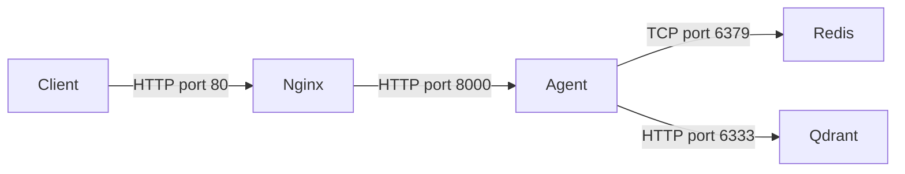

# Mission Answers — Day 14

## Part 1 — Localhost và production

### 1.1. Anti-pattern trong bản develop

1. `OPENAI_API_KEY` nằm trong mã nguồn. Một secret thật ở đây sẽ đi theo mọi bản clone và lịch sử Git.
2. `DATABASE_URL` chứa thông tin đăng nhập và trỏ thẳng đến localhost. Đổi máy hoặc môi trường đòi sửa code.
3. `print` ghi cả API key, câu hỏi và câu trả lời. Log thiếu cấu trúc cố định và có thể làm lộ thông tin.
4. App chỉ có `/` và `/ask`. Nền tảng thiếu liveness probe và load balancer thiếu readiness probe.
5. `uvicorn.run` gắn cứng host `localhost` và port 8000. Container phải nghe trên giao diện và cổng mà nền tảng định tuyến vào.
6. `reload=True` bật cơ chế reload dành cho phát triển, làm phát sinh tiến trình giám sát và khả năng khởi động lại khi file đổi.
7. App thiếu vòng đời dọn tài nguyên khi dừng, ví dụ đóng kết nối và ghi nhận shutdown.

Mục 5 có thể đối chiếu trực tiếp với [develop/app.py, dòng 43–45](01-localhost-vs-production/develop/app.py#L43-L45) và [production/config.py, dòng 17–19](01-localhost-vs-production/production/config.py#L17-L19).

### 1.2. Chạy bản develop

`curl -i -X POST 'http://127.0.0.1:8000/ask?question=Hello'`

```http
HTTP/1.1 200 OK
content-type: application/json

{"answer":"Agent đang hoạt động tốt! (mock response) Hỏi thêm câu hỏi đi nhé."}
```

### 1.3. So sánh hai bản

| Tính năng | Develop | Production | Vì sao quan trọng |
| --- | --- | --- | --- |
| Cấu hình | Biến cứng trong mã | Đọc host, port, môi trường và key qua env | Dùng cùng code cho local, staging và cloud |
| Health check | Thiếu endpoint chuyên dụng | Có `/health` và `/ready` | Phân biệt tiến trình còn chạy với khả năng phục vụ |
| Logging | `print` câu hỏi, câu trả lời và key | Log request/response có JSON, lifecycle có log văn bản | Dễ tìm theo trường và giảm nguy cơ lộ secret |
| Shutdown | Thiếu hook dọn tài nguyên | Lifespan FastAPI và xử lý SIGTERM của server | Dọn tài nguyên khi worker dừng và hạn chế ngắt request giữa chừng |

## Part 2 — Docker

### 2.1. Dockerfile cơ bản

1. Base image là `python:3.11`.
2. Working directory là `/app`.
3. `COPY requirements.txt` và cài dependency trước khi copy mã ứng dụng để Docker tái sử dụng layer cài đặt khi chỉ mã thay đổi.
4. `ENTRYPOINT` đặt chương trình chính. `CMD` đặt lệnh mặc định khi thiếu entrypoint hoặc cung cấp đối số mặc định cho entrypoint. Đối số sau tên image trong `docker run` có thể thay `CMD`.

### 2.2–2.3. Gọi container và so sánh image

Builder dùng nền slim rồi cài gcc, libpq-dev và các Python package. Stage runtime tạo user riêng, chỉ copy package đã cài cùng code cần chạy. Compiler và các package build ở lại builder, nhờ đó runtime nhỏ hơn.

`docker images my-agent` trên runner hiển thị:

```text
IMAGE               ID             DISK USAGE   CONTENT SIZE
my-agent:advanced   b3a0470d1bf1        240MB         57.4MB
my-agent:develop    b3bf905ff683       1.67GB          426MB
```

Dùng số byte `Content Size` để tính cùng một đại lượng. Develop là 426.320.150 byte và advanced là 57.409.091 byte. Advanced giảm **86,53%**, tính bằng `(426320150 - 57409091) / 426320150 × 100`.

Container develop trả kết quả sau cho `POST /ask?question=What%20is%20Docker%3F`.

```http
HTTP/1.1 200 OK
content-type: application/json

{"answer":"Container là cách đóng gói app để chạy ở mọi nơi. Build once, run anywhere!"}
```

### 2.4. Docker Compose



Agent, Redis, Qdrant và Nginx cùng mạng `internal`. Chỉ Nginx publish cổng ra host. Compose chờ healthcheck của Redis và Qdrant trước khi khởi động agent. Agent nhận URL qua env. Qdrant được cấu hình cho vector store, còn truy vấn `/ask` ở ví dụ này dùng mock LLM.

Kết quả thử qua Nginx:

```text
GET  http://127.0.0.1/health → HTTP/1.1 200 OK, Server: nginx
POST http://127.0.0.1/ask    → HTTP/1.1 200 OK, Server: nginx
```

`/health` trả `"status":"ok"`. `/ask` nhận JSON `{"question":"Explain microservices"}` và trả JSON có `answer`.

## Part 3 — Cloud Deployment

### 3.1. Railway

Agent Part 6 đã chạy trên Railway tại https://agent-production-8a157829.up.railway.app. Bốn HTTP code thực đo là 200, 200, 401 và 200. [Cấu hình và kết quả CP6](DEPLOYMENT.md).

### 3.2. So sánh Railway và Render

| | Railway | Render |
| --- | --- | --- |
| Định nghĩa | `railway.toml` dùng `[build]` và `[deploy]` cho một service | `render.yaml` là Blueprint có thể khai báo nhiều service |
| Build và kiểm tra | `builder = "DOCKERFILE"`, `dockerfilePath = "Dockerfile"`, `healthcheckPath = "/health"` | `runtime: docker`, `rootDir: 06-lab-complete`, `healthCheckPath: /health` |
| Redis | Tạo Redis trong cùng project và tham chiếu biến của service Redis | Khai báo Key Value rồi ánh xạ `connectionString` vào `REDIS_URL` |
| API key | Đặt biến service trong Railway | Blueprint dùng `generateValue: true` |

### 3.3. Cloud Run

1. Cloud Build cài dependencies và chạy `pytest` trong bước `test`.
2. Sau bước test, Docker build image với tag theo `$COMMIT_SHA` và `latest`, dùng image `latest` làm nguồn cache.
3. Pipeline push cả hai tag, rồi triển khai tag theo commit lên Cloud Run ở `asia-southeast1` và lấy secret từ Secret Manager.
4. `service.yaml` mô tả cấu hình khai báo tương ứng như giới hạn instance, concurrency, tài nguyên, liveness `/health` và startup probe `/ready`.
5. Bước test trong mẫu cần `set -e` hoặc nối bằng `&&` trước `echo` để mã lỗi của pytest thực sự chặn bước build.

## Part 4 — API Security

### 4.1–4.3. API key, JWT và rate limit

Bản develop đọc `X-API-Key` trong dependency kiểm tra trước `/ask`. Bản mẫu trả HTTP 401 khi thiếu key và 403 khi key sai. Agent Part 6 dùng 401 cho cả hai trường hợp theo hợp đồng của bộ chấm. Để rotate, cập nhật `AGENT_API_KEY` ở môi trường chạy, khởi động lại bản triển khai rồi cập nhật client sang key mới.

Bản nâng cao cấp bearer token ở `POST /auth/token`. Token có danh tính, role và hạn 60 phút. Server xác minh chữ ký và thời hạn trước khi dùng role. Rate limiter dùng danh sách timestamp theo user trong cửa sổ trượt 60 giây. Mẫu chọn limiter theo role đã xác thực. Student có 10 request/phút, còn admin có 100 request/phút.

Trích kết quả `curl -i` từ hai bản mẫu:

```http
# Develop, thiếu API key
HTTP/1.1 401 Unauthorized
content-type: application/json

{"detail":"Missing API key. Include header: X-API-Key: <your-key>"}

# Develop, API key hợp lệ
HTTP/1.1 200 OK
content-type: application/json

{"question":"Hello","answer":"Agent đang hoạt động tốt! (mock response) Hỏi thêm câu hỏi đi nhé."}

# Production, request số 11 với JWT của tài khoản student
HTTP/1.1 429 Too Many Requests
x-ratelimit-limit: 10
x-ratelimit-remaining: 0
retry-after: 59
content-type: application/json

{"detail":{"error":"Rate limit exceeded","limit":10,"window_seconds":60,"retry_after_seconds":59}}
```

Vòng lặp 20 lượt nhận 10 phản hồi 200 rồi 10 phản hồi 429. Request 11 là lần đầu chạm giới hạn. JWT đã được che trong tài liệu.

### 4.4. Cost guard

Ngân sách tháng theo user có thể lưu dưới key `budget:{user_id}:{YYYY-MM}` với TTL tới đầu tháng sau theo UTC. Trong một script Lua, đọc chi phí đã tích lũy, kiểm tra chi phí dự trù với hạn mức, rồi giữ chỗ bằng lệnh cộng nếu đủ ngân sách. Khi nhận usage từ LLM, tính chi phí token thực tế và hoàn phần dư. Nếu vượt budget, trả 402 trước khi gọi upstream. Rate limit giới hạn số lượt theo thời gian, còn cost guard tính theo số tiền, nên mỗi biện pháp xử lý một kiểu tải. Part 6 áp dụng cùng nguyên tắc với ngân sách toàn agent theo ngày.

## Part 5 — Scaling & Reliability

1. `/health` giúp kiểm tra liveness, tức tiến trình còn sống. `/ready` giúp quyết định có chuyển traffic vào instance. Part 6 trả `/ready` 503 khi Redis ngừng phản hồi và vẫn trả `/health` 200.
2. Khi nhận SIGTERM, Uvicorn dừng nhận xử lý mới, đợi request đang chạy và gọi FastAPI lifespan để đóng Redis. Part 6 dùng hai worker do Uvicorn giám sát để PID 1 điều phối việc dừng.
3. State trong RAM chỉ có ở một instance. Lưu history trong Redis cho phép các replica dùng chung session và giữ history khi một replica dừng.
4. Nginx chuyển `POST /chat` đến upstream `agent:8000`; trường `served_by` cho thấy replica xử lý. `test_stateless.py` gửi năm câu trong một session rồi đọc history.

Chạy bản develop bằng `python app.py`. `GET /health` và `GET /ready` đều trả 200. Khi gửi SIGTERM trong lúc `POST /ask?question=Long%20task` đang chạy, request vẫn trả 200 và log ghi `Application shutdown complete`.

Chạy stack với `--scale agent=3` và `python test_stateless.py`. Kết quả:

```text
Session ID: dd6791a2-4e27-47dd-b2cf-aa9f17a86b42
Total requests: 5
Instances used: {'instance-5a2efc', 'instance-6aeffd', 'instance-d79ff0'}
Total messages: 10
```

Sau khi dừng một replica, gửi câu thứ sáu với **cùng** session ID qua Nginx. Instance `instance-5a2efc` trả lời và history tăng lên **12 tin nhắn**, gồm đủ sáu cặp hỏi đáp. [Lượt chạy Part 5](https://github.com/hung309911/K5-L3A-DAY14-NguyenQuocHung-2A202603553-Deployment-Benchmark-Observability/actions/runs/45647235195).

## Part 6 — Production readiness

Chạy bộ chấm nguyên bản trên GitHub Actions Linux với Docker. [Log lượt chạy](https://github.com/hung309911/K5-L3A-DAY14-NguyenQuocHung-2A202603553-Deployment-Benchmark-Observability/actions/runs/45645597090).

Image Part 6 đo được 63 MB theo script chấm. Khi thử SIGTERM, request đang xử lý vẫn trả 200. Docker dừng sau 0,8 giây với exit code 0.

```text
  📋 Checklist Deliverable
     ✅ Dockerfile (multi-stage, < 500 MB)
     ✅ docker-compose.yml (agent + redis)
     ✅ .dockerignore
     ✅ Health check endpoint (GET /health)
     ✅ Readiness endpoint (GET /ready)
     ✅ API Key authentication
     ✅ Rate limiting
     ✅ Cost guard
     ✅ Config từ environment variables
     ✅ Structured logging
     ✅ Graceful shutdown
     ✅ Public URL ready (Railway / Render config)
----------------------------------------------------------------
  Result: 12/12 tiêu chí đạt · 43/43 checks passed
  🎉 PASS 12/12 — PRODUCTION READY! Deploy nào!
================================================================
```

## AI log

- Yêu cầu cho Codex là đọc đề K5, triển khai bản khung Part 6, hỗ trợ các câu trả lời và thu số đo thật.
- Codex viết phần xác thực, Redis, giới hạn request, giữ chỗ ngân sách, JSON log, cấu hình container và mẫu triển khai. Codex bổ sung hai mục kiến thức về JWT và HPA, chạy kiểm tra trên Linux và soạn các báo cáo từ log, JSON và CSV.
- Các câu trả lời và code trong repo có hỗ trợ AI. Lượt kiểm tra được ghi theo những gì Codex đã chạy. Phần tự sửa và tự chạy lại của học viên chưa được ghi nhận.
